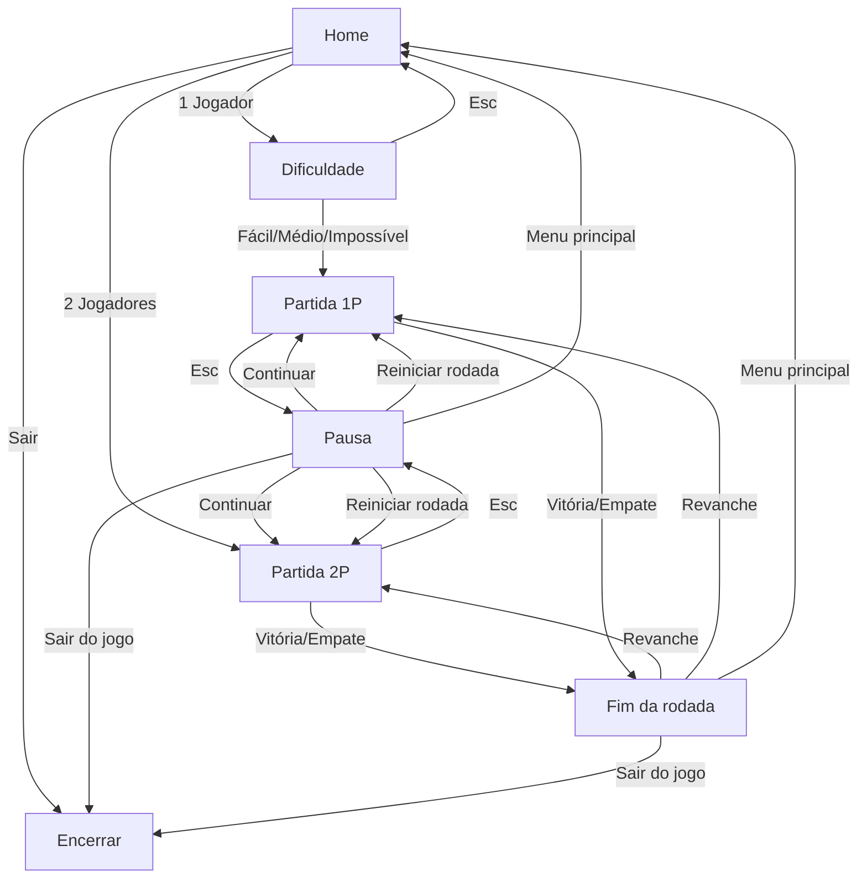
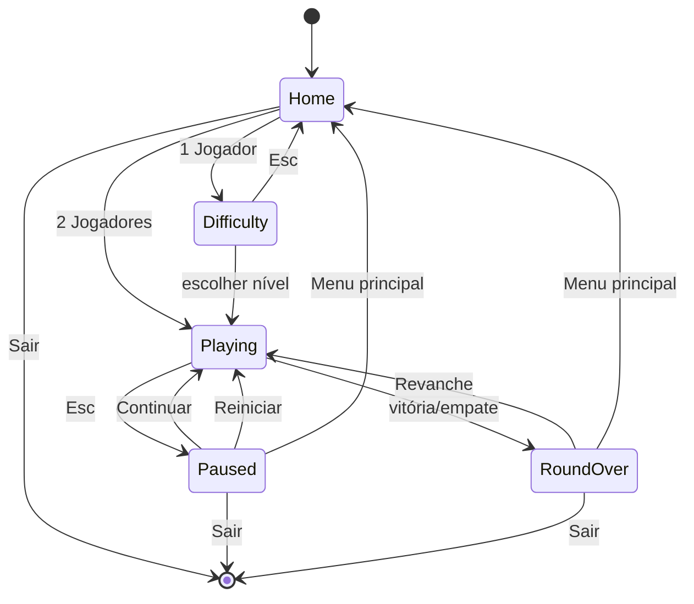

# 01 — Game Design

## 1. Identidade

- **Nome:** Velha Clássica.
- **Subtítulo pt-BR:** Jogo da Velha · Mesa de Madeira.
- **Subtítulo EN:** Tic-Tac-Toe · Wood & Paper.
- **Gênero:** jogo de tabuleiro abstrato, partida rápida, foco local.
- **Plataformas:** terminal Linux no desktop e console local de servidor.
- **Faixa de sessão:** 1 a 10 minutos por sessão; uma rodada dura menos de 1 minuto.

A marca "Velha Clássica" permanece igual nos dois idiomas. O subtítulo e todos
os textos de interface são traduzidos.

## 2. Pilares de experiência

1. **Clássico e legível:** as regras são exatamente as do jogo da velha; nenhuma
   regra especial deve atrapalhar a leitura do tabuleiro.
2. **Tátil e artesanal:** madeira escura, papel envelhecido, tinta e latão. O
   visual deve lembrar uma mesa física, sem virar um fliperama ruidoso.
3. **Elegância discreta:** animações curtas, som baixo e ornamentos contidos.
   O tabuleiro é o herói visual.
4. **Local e acolhedor:** dois jogadores no mesmo teclado, sem cadastro, sem rede,
   sem tempo limite e sem pressão.
5. **Acessível por padrão:** X e O são distinguíveis pela forma, não apenas pela
   cor; todas as ações têm equivalente em teclado; há opção de reduzir movimento.

## 3. Público e objetivos

- Pessoas que querem uma pausa curta no terminal.
- Usuários de Linux que apreciam TUIs bem acabadas.
- Duas pessoas compartilhando o mesmo teclado.
- Entusiastas de Rust e de interfaces retrofuturistas locais.

Objetivos de sucesso:

- entender e iniciar uma partida em menos de 10 segundos;
- nunca deixar o terminal corrompido ao sair, inclusive em erro ou pânico;
- IA impossível nunca perder;
- funcionar bem em 1920 × 1080 ocupando cerca de 70% da tela;
- manter a mesma identidade visual no desktop e no console do servidor.

## 4. Regras

1. O tabuleiro é uma grade 3 × 3.
2. Jogador 1 usa **X**; jogador 2 (ou a IA) usa **O**.
3. X começa a primeira rodada.
4. Os jogadores alternam turnos, marcando uma casa vazia por vez.
5. Vence quem completar uma linha, coluna ou diagonal com o próprio símbolo.
6. Se as nove casas forem preenchidas sem vencedor, a rodada termina em empate.
7. Uma jogada em casa ocupada é inválida: não troca o turno, não altera o placar
   e gera feedback visual e sonoro curto.
8. Não há limite de tempo, desfazer, dicas ou pontuação por velocidade.

### Linhas de vitória

```text
0 1 2
3 4 5
6 7 8

Linhas: [0,1,2] [3,4,5] [6,7,8]
Colunas: [0,3,6] [1,4,7] [2,5,8]
Diagonais: [0,4,8] [2,4,6]
```

## 5. Modos de jogo

### 5.1 Um jogador vs IA

- O humano é X e sempre começa a rodada.
- A IA é O.
- Antes da partida, o jogador escolhe a dificuldade: Fácil, Médio ou Impossível.
- A IA exibe "IA pensando" por 450–800 ms antes de jogar, para dar ritmo à ação.
- Durante o turno da IA, apenas pausa e alternância de idioma/som são aceitas;
  o tabuleiro não aceita marcações.
- O placar mostra "Você", "IA" e "Empates".

### 5.2 Dois jogadores local

- Jogador 1 é X; Jogador 2 é O.
- A primeira rodada começa com X.
- Em cada revanche, o jogador que inicia alterna. Os símbolos não mudam.
- O placar mostra "Jogador 1", "Jogador 2" e "Empates".
- Não há nomes editáveis na v1.0.

### 5.3 Definição de rodada, partida e sessão

| Termo | Significado |
| --- | --- |
| Rodada | Uma partida completa de tic-tac-toe, até vitória ou empate. |
| Revanche | Nova rodada com os mesmos jogadores/modo/dificuldade. |
| Sessão | Sequência de rodadas e revanches até voltar ao menu principal. |
| Placar da sessão | Vitórias de cada lado e empates acumulados durante a sessão. |

O placar é mantido em memória. Ele é preservado em revanches e zerado quando o
jogador volta ao menu principal, troca de modo ou de dificuldade, ou encerra o
programa. Não há persistência em disco.

## 6. Inteligência artificial

A IA é uma função pura, exceto pelo gerador aleatório:

```text
choose_move(board, difficulty, rng) -> Cell
```

A função nunca escolhe uma casa ocupada. Os atrasos de "pensamento" ficam na
camada de aplicação, não no algoritmo, para que os testes sejam instantâneos.

### 6.1 Fácil

Objetivo: ser vencível com facilidade, mas não totalmente aleatória.

Algoritmo:

1. Liste as jogadas que dão vitória imediata à IA. Se existirem, escolha uma
   delas com probabilidade de 35%.
2. Caso contrário, liste as jogadas que dão vitória imediata ao oponente. Se
   existirem, bloqueie uma delas com probabilidade de 35%.
3. Se nenhuma das condições acima for sorteada, escolha uniformemente entre as
   casas vazias.
4. Nunca escolha casa ocupada.

### 6.2 Médio

Objetivo: punir erros e bloquear ameaças, mas ainda permitir ser vencida por
sequências de garfos (forks).

Algoritmo:

1. Se houver vitória imediata, jogue nela.
2. Se o oponente tiver vitória imediata, bloqueie.
3. Caso contrário, pontue cada casa vazia:
   - jogada que cria duas ou mais ameaças de vitória: +800;
   - centro: +300;
   - canto cujo oposto está ocupado pelo oponente: +200;
   - canto: +100;
   - borda: +50;
   - jitter aleatório de 0–49 para variar o jogo.
4. Escolha a maior pontuação.
5. Com 10% de chance, troque a escolha por uma casa vazia aleatória, **somente**
   depois das verificações de vitória e bloqueio.

### 6.3 Impossível

Objetivo: nunca perder. Empate é o melhor resultado possível para o humano.

Algoritmo:

- Minimax completo com memoização das posições avaliadas.
- A IA (O) maximiza; o humano (X) minimiza.
- Vitória da IA vale `+10 - profundidade`.
- Vitória do humano vale `-10 + profundidade`.
- Empate vale `0`.
- Entre jogadas com a mesma pontuação ótima, escolha aleatoriamente para variar
  aberturas, sem comprometer a otimalidade.
- O espaço de estados é pequeno; a memoização mantém a resposta em poucos
  milissegundos.

Critério de aceite: em simulação exaustiva de todas as respostas humanas a partir
do tabuleiro vazio, a IA Impossível nunca perde.

### 6.4 Rótulos e descrições

| Nível | pt-BR | Inglês | Descrição pt-BR | Descrição EN |
| --- | --- | --- | --- | --- |
| Easy | Fácil | Easy | Joga sem muita estratégia. | Plays without much strategy. |
| Medium | Médio | Medium | Aproveita erros e bloqueia ameaças. | Punishes mistakes and blocks threats. |
| Impossible | Impossível | Impossible | Nunca perde. Empate já é vitória. | Never loses. A draw is a win. |

## 7. Placar e revanche

- O placar exibe três contadores: lado 1, lado 2 e empates.
- Cada rodada encerrada incrementa exatamente um contador, uma única vez.
- Empate não incrementa vitórias.
- A revanche reinicia o tabuleiro, mantém o placar e alterna o iniciante no modo
  2 jogadores.
- No modo 1 jogador, o humano sempre começa novamente.
- A rodada finalizada permanece visível até o jogador escolher uma ação.
- "Menu principal" encerra a sessão e zera o placar ao entrar em um novo modo.

## 8. Fluxo de telas



### 8.1 Home

- Título "Velha Clássica" e subtítulo.
- Itens: "1 Jogador", "2 Jogadores", "Sair".
- Rodapé: idioma atual, estado do som, versão.
- `F2` alterna o idioma; `M` liga/desliga o som.
- `Q` sai do jogo a partir da Home.

### 8.2 Seleção de dificuldade

- Título "Escolha a dificuldade".
- Três opções com nome e descrição.
- "Voltar" ou `Esc` retorna à Home.
- `Enter` inicia a partida com o nível selecionado.
- O foco inicial é "Fácil".

### 8.3 Partida

- Cabeçalho: marca, modo, dificuldade e indicadores de idioma/som.
- Tabuleiro em destaque.
- Painel lateral (layout amplo) ou linha de status (layout compacto):
  - de quem é o turno;
  - símbolo do humano, quando aplicável;
  - placar da sessão;
  - atalhos contextuais.
- Rodapé com atalhos e versão.
- Feedback de jogada inválida em status, por 900 ms.

### 8.4 Pausa

Sobreposição escura com cartão de papel e ações:

1. Continuar.
2. Reiniciar rodada.
3. Menu principal.
4. Sair do jogo.

`Esc` fecha a pausa e continua. "Reiniciar rodada" não altera o placar. "Menu
principal" encerra a sessão.

### 8.5 Fim da rodada

- O tabuleiro permanece visível com a linha vencedora destacada.
- Um cartão de resultado aparece ao lado/abaixo, sem cobrir a linha vencedora.
- Ações: Revanche, Menu principal, Sair do jogo.
- Atalho `R` inicia revanche; `Esc` vai ao menu principal.
- Em vitória, o texto identifica o vencedor; em empate, "Empate!".

### 8.6 Saída

- A saída deve restaurar cursor, modo de terminal, tela alternativa e modo texto
  do console (no backend framebuffer).
- Não há confirmação de saída na Home. Em pausa, "Sair do jogo" é explícito.
- `Ctrl+C` é tratado como pedido de saída e também restaura o terminal.

## 9. Controles

| Contexto | Tecla | Ação |
| --- | --- | --- |
| Menus | `↑`/`↓`, `W`/`S` | Mover seleção |
| Menus | `Enter`, `Espaço` | Confirmar |
| Menus | `Esc` | Voltar |
| Partida | `↑`/`↓`/`←`/`→`, `WASD` | Mover cursor pelo tabuleiro |
| Partida | `Enter`, `Espaço` | Marcar casa selecionada |
| Partida | `Esc` | Abrir pausa |
| Fim da rodada | `↑`/`↓`, `Enter` | Escolher ação |
| Fim da rodada | `R` | Revanche |
| Fim da rodada | `Esc` | Menu principal |
| Pausa | `↑`/`↓`, `Enter` | Escolher ação |
| Pausa | `Esc` | Continuar |
| Global | `F2` | Alternar pt-BR/inglês |
| Global | `M` | Ligar/desligar som |
| Home | `Q` | Sair |
| Pausa | `Q` | Sair do jogo (equivalente à ação) |

Regras de foco:

- O cursor do tabuleiro começa no centro (casa 4) em cada rodada.
- O movimento do cursor não atravessa as bordas; ele para na última casa.
- O cursor pode passar por casas ocupadas, mas não pode marcá-las.
- O menu não usa mouse na v1.0.
- Teclas não mapeadas são ignoradas, sem som ou mensagem.
- Entradas repetidas por segurar a tecla são aceitas para navegação; para marcar,
  apenas o primeiro `Enter`/`Espaço` conta até o estado mudar.

## 10. Estados e transições



Estados internos mínimos:

- `Screen`: Home, Difficulty, Playing, Paused, RoundOver.
- `Mode`: OnePlayer(Difficulty), TwoPlayers.
- `Outcome`: InProgress, Win { mark, line }, Draw.
- `turn`: X ou O.
- `starter`: X ou O para a rodada atual.
- `selected`: índice 0–8.
- `session_score`: P1, P2/IA, empates.
- `ai_pending`: booleano + instante de conclusão.
- `status_message`: texto temporário e instante de expiração.
- `sound_enabled`, `locale`, `animations_enabled`.

## 11. Feedback visual e sonoro

| Evento | Visual | Som |
| --- | --- | --- |
| Mover cursor | Brackets de latão deslizam; marca fantasma sutil | Tick curto |
| Marcar X | Carimbo de tinta azul-petróleo; leve escala e sangramento | Batida seca de madeira |
| Marcar O | Carimbo vinho; leve escala e sangramento | Ruído suave de papel |
| Jogada inválida | Status pisca em vermelho; sem mexer no tabuleiro | Baque grave curto |
| IA pensando | Três pontos animados no status | Silêncio |
| Vitória | Linha de latão desenhada; células vencedoras aquecidas; selo | Arpejo curto |
| Empate | Selo de empate; brilho neutro | Duas notas graves |
| Navegação de menu | Marcador de latão no item focado | Blip baixo |
| Pausa | Sobreposição escura; cartão sobe | Nenhum |

As especificações de tempo, easing e paleta estão em
[03 — Design Visual](03-visual-design.md). O áudio é sempre opcional e silencioso
quando não há dispositivo disponível.

## 12. Idioma

- pt-BR é o idioma padrão em toda inicialização.
- `F2` alterna instantaneamente para inglês e de volta para português.
- A troca não reinicia a rodada, não altera o placar e não fecha a pausa.
- Updates de tela, descrições, status e atalhos mudam no mesmo frame.
- O catálogo completo está em [08 — Catálogo i18n](08-i18n-catalog.md).
- A escolha de idioma vale apenas para a sessão; não é persistida.
- `--lang pt|en` pode definir o idioma inicial via CLI.

## 13. Acessibilidade

- X e O têm formas distintas; cor não é o único indicador.
- Linha vencedora também recebe um marcador textual/simbólico no status.
- Contraste mínimo de 4,5:1 para texto normal e 3:1 para texto grande.
- Animações não piscam mais de 3 vezes por segundo.
- `--no-animations` remove pulso, tremor, escala e desenho progressivo, mantendo
  o feedback por cor/estado e reduzindo o atraso da IA para 250 ms.
- `NO_COLOR` remove cor, mantendo formas, bordas e texto.
- O jogo não depende de mouse, som ou protocolo de imagem.
- Em terminais menores que 80 × 24, uma mensagem clara informa o tamanho mínimo.
- Não há entradas cronometradas.

## 14. Fora do escopo da v1.0

- Multiplayer em rede ou online.
- Persistência de placar, configurações ou histórico.
- Mouse.
- Temas alternáveis.
- Tela de ajuda/tutorial dedicada.
- IA contra IA ou modo demonstração.
- Tabuleiro 4 × 4 ou variações de regra.
- Undo, dicas, cronômetro e conquistas.
- Música de fundo.
- Edição de nomes de jogadores.
- Suporte oficial a SSH, Windows ou macOS.

## 15. Critérios de aceite funcional

Uma versão é considerada funcional quando:

1. É possível iniciar uma partida 1P e 2P a partir da Home.
2. Todas as linhas de vitória e o empate são detectados corretamente.
3. Jogadas inválidas não alteram turno nem placar.
4. A IA Impossível nunca perde em teste exaustivo.
5. O placar da sessão incrementa uma única vez por rodada e é preservado em
   revanches.
6. O iniciante alterna corretamente em revanches 2P.
7. `F2` e `M` funcionam em todas as telas sem quebrar o estado do jogo.
8. A saída restaura o terminal/console mesmo após erro ou `Ctrl+C`.
9. O jogo é totalmente operável só com teclado.
10. O layout cabe e permanece legível em 80 × 24 e em 1920 × 1080.
