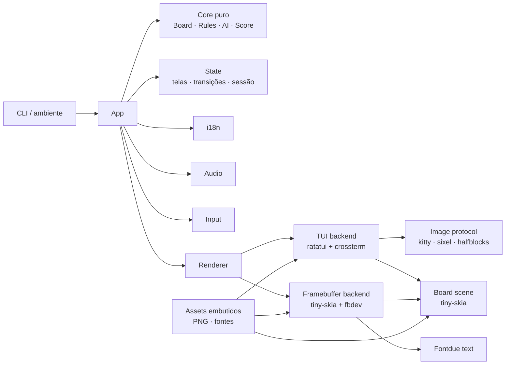

# 02 — Especificação Técnica

## 1. Objetivos

- Implementar o jogo descrito em [01 — Game Design](01-game-design.md) em Rust.
- Rodar localmente no Zorin OS dentro de um terminal colorido.
- Rodar localmente no console de um Ubuntu Server sem X/Wayland a partir da v1.1.
- Exibir PNGs reais no desktop (Kitty/Sixel) e no framebuffer do servidor.
- Manter o terminal/console sempre restaurável, mesmo em erro, pânico ou `Ctrl+C`.
- Não depender de rede, arquivos externos em runtime ou serviços do sistema.

## 2. Não objetivos

- Suporte a Windows, macOS, navegador ou mobile.
- SSH como cenário principal.
- Persistência de placar, configurações ou histórico.
- Mouse, temas alternáveis, multiplayer em rede ou áudio em tempo real complexo.
- Impressão de imagens em terminais sem protocolo como se fossem PNGs de alta
  resolução; nesses casos há fallback declarado.

## 3. Plataformas e pré-requisitos

### 3.1 Desktop — Zorin OS

- Linux x86_64, sessão gráfica local.
- Terminal local com truecolor (recomendado) e, de preferência, Kitty ou WezTerm.
- Fonte monoespaçada com suporte a box drawing, setas e caracteres geométricos.
- Tamanho de célula próximo de 10 × 20 px para que 70% de 1920 × 1080 resulte em
  aproximadamente 134 × 38 células.
- Áudio via ALSA/PulseAudio/PipeWire, se disponível.

### 3.2 Servidor — Ubuntu Server

- Ubuntu Server 24.04 LTS ou compatível, console local (TTY) com monitor e teclado.
- Sem X11/Wayland.
- `/dev/fb0` disponível (efifb, simpledrm ou driver equivalente).
- Usuário com permissão de leitura/escrita no framebuffer e permissão para
  `KDSETMODE` no TTY ativo.
- Recomendado: usuário no grupo `video`.
- Entrada pelo teclado do console; não é necessário `evdev` nem root.
- Áudio é opcional; sem dispositivo, o jogo permanece silencioso.

Comandos de diagnóstico previstos na documentação de instalação:

```bash
ls -l /dev/fb0
cat /sys/class/graphics/fb0/virtual_size
cat /sys/class/graphics/fb0/bits_per_pixel
sudo usermod -aG video "$USER"
```

### 3.3 Fora de suporte

- Execução via SSH: o backend TUI pode funcionar como fallback, mas protocolos de
  imagem e áudio não são garantidos.
- Framebuffer em máquina virtual sem console gráfico ou com driver proprietário
  que não exponha `/dev/fb0`.
- Terminais com menos de 80 × 24 células.
- Arquiteturas diferentes de x86_64 na v1.0/v1.1 (código deve evitar suposições
  desnecessárias, mas não será testado).

## 4. Toolchain e convenções

- Rust stable, edição 2021.
- MSRV definida na implementação; não inferior a 1.82.
- `rustfmt` e `clippy` obrigatórios.
- Código e identificadores em inglês.
- Textos de UI em pt-BR e inglês via catálogo i18n.
- Comentários de código apenas quando necessários, em inglês.
- `Cargo.lock` versionado.
- Sem `unsafe` fora dos módulos de sistema (`framebuffer`, `tty`), com comentário
  de segurança e isolamento.
- Nenhuma chamada de rede em runtime.

## 5. Dependências previstas

As versões exatas serão fixadas no `Cargo.lock` na implementação, usando as
últimas versões estáveis compatíveis. A tabela abaixo define a finalidade.

| Crate | Uso | Feature |
| --- | --- | --- |
| `ratatui` | Widgets, buffer e layout da TUI | padrão |
| `crossterm` | Raw mode, eventos de teclado, alternate screen, cores | padrão |
| `ratatui-image` | Detecção e exibição de PNG via Kitty/Sixel/iTerm2/half-blocks | padrão |
| `image` | Decodificação de PNG, composição e conversão de formatos | padrão |
| `tiny-skia` | Rasterização vetorial do tabuleiro, painéis e overlays | padrão |
| `fontdue` | Rasterização de texto para o backend framebuffer | v1.1 (implementado) |
| `clap` | CLI declarativa | padrão |
| RNG próprio | Aleatoriedade da IA e variação de aberturas | `util/rng.rs` |
| `libloading` | Carregamento dinâmico de `libasound.so.2` para áudio Linux | `audio` (padrão) |
| `libc` | ioctls, termios, sinais, mmap do framebuffer | Linux |
| `signal-hook` | Restauração em SIGINT/SIGTERM/SIGHUP | Linux |
| `tracing` + `tracing-subscriber` | Logs opt-in em arquivo | padrão |
| `thiserror` | Erros de domínio e backends | padrão |
| `anyhow` | Contexto na borda da aplicação | padrão |
| `unicode-width` | Medição de texto na TUI | padrão |
| `bytemuck` | Conversão de pixels para formatos do framebuffer | Linux |
| `resvg` | SVG → PNG no `xtask` | dev/build |
| `oxipng` | Otimização opcional dos PNGs | dev/build |
| `insta` | Snapshots de TUI | dev |
| `proptest` | Propriedades do núcleo e da IA | dev |

`drm`/KMS não entra na v1.1; fica no backlog para uma versão posterior.

Features:

```toml
[features]
default = ["audio"]
audio = ["dep:libloading"]
```

O backend framebuffer é compilado por `cfg(target_os = "linux")`; não precisa de
feature própria. No servidor, compilar com `--no-default-features` para remover o
backend de áudio e a crate `libloading`; o ALSA só é acessado quando a feature
está ativa.

## 6. Arquitetura



Princípios:

1. **Núcleo puro:** regras, tabuleiro, IA e placar não conhecem terminal, cores,
   arquivos ou tempo real. São testáveis sem TTY.
2. **Estado explícito:** a aplicação mantém `App`, `Game`, `SessionScore` e
   `UiState`; renderizadores recebem um snapshot imutável.
3. **Backends substituíveis:** a mesma lógica alimenta TUI e framebuffer.
4. **Assets embutidos:** `include_bytes!` evita caminhos quebrados e permite um
   binário único. A geração dos PNGs é feita em tempo de desenvolvimento.
5. **Restauração garantida:** todo recurso de sistema tem um guard RAII e um
   caminho de restauração em pânico/sinal.

## 7. Fluxo de execução e event loop

```text
main
  ├─ parse CLI
  ├─ init logging (opt-in)
  ├─ carregar assets + fontes
  ├─ escolher backend e idioma
  ├─ inicializar áudio (se habilitado)
  ├─ loop:
  │    ├─ poll de eventos (timeout dependente de animação)
  │    ├─ converter eventos em ações
  │    ├─ atualizar estado e timers (IA, animações, status)
  │    ├─ se dirty: renderizar frame
  │    └─ se quit: sair do loop
  └─ restore terminal/console
```

- **TUI:** `crossterm::event::poll` com timeout de 16 ms durante animações e
  100 ms ocioso. Redesenho apenas quando dirty.
- **Framebuffer:** alvo de 60 FPS durante animações; 30 FPS em estado ocioso se
  houver cursor pulsante; renderização sob demanda quando não há animação.
- **Timers:** baseados em `Instant`; nada depende de contagem de frames.
- **IA:** agenda a jogada para `now + 450..800 ms`, desenhando o estado "pensando".
  Pausa congela o timer; retomar recalcula o restante ou aplica a jogada.
- **Resize:** recalcula layout, recria buffers e protocolo de imagem. No
  framebuffer, a resolução é lida uma vez; mudanças de modo exigem reinício.
- **Sinais:** SIGINT, SIGTERM e SIGHUP solicitam saída limpa. Panic hook restaura
  e imprime o erro após a restauração.

### 7.1 Contrato conceitual dos backends

```rust
pub trait Renderer {
    fn resize(&mut self, size: Size) -> Result<()>;
    fn draw(&mut self, frame: &Frame) -> Result<()>;
    fn present(&mut self) -> Result<()>;
    fn restore(&mut self) -> Result<()>;
}

pub trait InputSource {
    fn poll(&mut self, timeout: Duration) -> Result<Vec<InputEvent>>;
}
```

- `Frame` é um snapshot com tela, tabuleiro, textos já traduzidos, placar,
  animações e tokens de tema.
- Renderizadores não alteram o estado do jogo.
- Erros de backend são fatais e sempre passam pelo caminho de restauração.

## 8. Modelo de domínio

```rust
pub enum Mark { X, O }

pub struct Board {
    cells: [Option<Mark>; 9],
}

pub enum Outcome {
    InProgress,
    Win { mark: Mark, line: [usize; 3] },
    Draw,
}

pub enum Difficulty { Easy, Medium, Impossible }

pub enum Mode {
    OnePlayer(Difficulty),
    TwoPlayers,
}

pub struct SessionScore {
    pub p1_wins: u16,
    pub p2_wins: u16,
    pub draws: u16,
}

pub struct Game {
    pub board: Board,
    pub mode: Mode,
    pub turn: Mark,
    pub starter: Mark,
    pub outcome: Outcome,
    pub selected: usize,
    pub score: SessionScore,
    pub ai_pending: Option<Instant>,
}
```

Regras de implementação:

- Índice de casa: linha maior, 0–8.
- `Board::place(cell, mark)` valida limites, casa vazia e estado do jogo.
- `Outcome` é calculado após cada jogada e nunca recalculado de forma divergente.
- O placar é atualizado na transição para `RoundOver`, com proteção contra dupla
  contagem.
- O iniciante da revanche é decidido fora do núcleo, na transição.
- A IA recebe uma cópia do tabuleiro; não pode alterar o original.
- Não há `unsafe` no núcleo.

## 9. Backend TUI (v1.0)

### 9.1 Inicialização

1. Verificar se `stdin`/`stdout` são TTY. Se não forem, erro claro em vez de lixo.
2. Detectar `TERM`, `COLORTERM`, `NO_COLOR` e tamanho.
3. Detectar o protocolo de imagem por variáveis de ambiente (`KITTY_WINDOW_ID`,
   `TERM`, `TERM_PROGRAM`) e usar `--image-protocol` como override. Sem indício de
   Kitty/Sixel/iTerm2, usar half-blocks; com `--no-images`/`none`, usar o
   tabuleiro textual de 16 cores. Não consultar stdio no startup, para não
   consumir teclas nem travar em terminais que não respondem.
4. Entrar em raw mode, alternate screen e esconder o cursor.
5. Instalar panic hook e guards de restauração.
6. Iniciar o loop.

### 9.2 Layout

- A área de jogo é calculada como 70% das dimensões do terminal, centralizada:
  - `cols_alvo = clamp(round(term_cols * 0.70), 80, 140)`;
  - `rows_alvo = clamp(round(term_rows * 0.70), 24, 45)`.
- Se o terminal for menor que 80 × 24, exibir mensagem de tamanho mínimo e não
  iniciar a partida.
- O fundo fora da área de jogo é preenchido com a cor de madeira escura.
- Breakpoints:
  - **Wide:** largura ≥ 120 e altura ≥ 34. Board à esquerda, painel de papel à
    direita.
  - **Compact:** largura ≥ 96 e altura ≥ 28. Board centralizado; status e placar
    abaixo.
  - **Minimal:** largura ≥ 80 e altura ≥ 24. Board, status em uma linha e rodapé.
- O tabuleiro mantém proporção quadrada: em células, a largura visual é
  aproximadamente o dobro da altura, compensando a proporção de célula ≈ 1:2.
- O rodapé e o cabeçalho têm alturas fixas por breakpoint; o restante é tabuleiro.

### 9.3 Renderização

- `ratatui::Terminal` com `CrosstermBackend`.
- Widgets de texto para cabeçalho, status, placar, menus e rodapé.
- Cena do tabuleiro rasterizada por `tiny-skia` e exibida:
  - Kitty/Sixel/iTerm2: PNG de alta resolução via `ratatui-image`;
  - half-blocks: mesma cena reduzida para células com truecolor;
  - legado: tabuleiro desenhado com box drawing e glifos X/O em blocos, 16 cores.
- A cena do tabuleiro é cacheada; só é regerada quando o estado do tabuleiro,
  cursor, animação ou tamanho mudar.
- Cursor pulsa suavemente; marca recém-colocada cresce/assenta em 140 ms; linha
  vencedora é revelada em 450 ms e o selo entra em fade; menus pulsam o marcador.
  Tudo desligado por `--no-animations`.
- Não usar emojis. Usar `✦`, `·`, `▸`, `─`, `╭╮╰╯`, `✕`, `◯` com fallback.
- Esconder o cursor do terminal durante o jogo.

### 9.4 Detecção de cor e protocolo

Ordem de decisão de cor:

1. `NO_COLOR` presente → monochrome.
2. `--color never` → monochrome.
3. `--color truecolor`, `COLORTERM=truecolor` ou `TERM` com `direct`/`truecolor`
   → truecolor.
4. `TERM` contém `256color` → 256 cores.
5. Caso contrário → 16 cores.

Ordem de protocolo:

1. `--no-images` → nenhum PNG.
2. `--image-protocol` explícito.
3. Detecção automática por variáveis de ambiente (`KITTY_WINDOW_ID`, `TERM`,
   `TERM_PROGRAM`).
4. Fallback half-blocks.
5. Fallback legado se não houver truecolor.

### 9.5 Restauração

- Guard de terminal: mostrar cursor, sair do alternate screen, desabilitar raw mode,
  limpar estilos.
- Executar em `Drop` e no panic hook.
- Se `stdout` falhar, tentar restaurar via `/dev/tty` quando disponível.
- Nunca imprimir diretamente durante o loop sem passar pelo renderer.

## 10. Backend framebuffer (v1.1)

### 10.1 Seleção e inicialização

- Ativado somente por `--backend fb`; `auto` permanece TUI (D-028). Nunca
  assumir framebuffer em uma sessão gráfica.
- Abrir `/dev/fb0` ou o caminho de `--fb-device`.
- Consultar `FBIOGET_VSCREENINFO` e `FBIOGET_FSCREENINFO` para resolução, bpp,
  line length e offsets de R/G/B.
- Mapear a memória com `mmap` via `libc`; `memmap2` foi dispensado para reduzir
  dependências (ver D-026 em `docs/07-decisions-and-risks.md`).
- Abrir/validar `/dev/tty` para entrada e ioctls de console.
- Colocar o VT ativo em `KD_GRAPHICS` para impedir que mensagens do kernel
  sobrescrevam o jogo. Guardar o modo anterior.
- Ativar raw mode e garantir que o cursor de texto não apareça.
- Instalar guards de restauração para `KD_TEXT`, termios e desmapeamento.

Pré-requisitos de permissão:

- Acesso RW a `/dev/fb0` (normalmente grupo `video`).
- Permissão para `KDSETMODE` no TTY ativo; se falhar, exibir erro acionável.
- Executar no console local, não dentro de SSH.

### 10.2 Formatos suportados

- 32 bpp com layouts RGBX/BGRX/XRGB/XBGR.
- 24 bpp RGB/BGR.
- 16 bpp RGB565.
- Outros formatos: erro claro com bpp/offsets detectados; sem tentativa de
  adivinhar.

A conversão é feita a partir de um canvas RGBA e deve respeitar offsets e
comprimentos de máscara reportados pelo driver.

### 10.3 Apresentação

- Canvas lógico de 1344 × 756 (70% de 1920 × 1080), escalado por um fator inteiro
  ou fracionário suave e centralizado.
- Fundo de madeira preenche todo o framebuffer; a composição de 70% fica
  centralizada.
- Preferir `FBIOPAN_DISPLAY` com dois buffers se `ypan` estiver disponível.
  Caso contrário, escrever o frame completo diretamente no mmap.
- Frame pacing com `Instant` e `sleep`; alvo de 60 FPS durante animações.
- Sincronização vertical não é garantida pelo fbdev; tearing leve é aceitável.
- Não usar DRM/KMS na v1.1; fica registrado como evolução.

### 10.4 Entrada e console

- A entrada vem do TTY local via `crossterm`, com raw mode.
- Setas, Enter, Espaço, Esc, WASD, F2, M e Q usam o mesmo mapeamento da TUI.
- Nenhum mouse.
- Ao sair, restaurar `KD_TEXT`, termios, cursor e mapeamento.
- Em troca de VT, o processo pode perder o framebuffer; a v1.1 deve tratar
  SIGUSR/SIGTERM restaurando o possível e encerrando com mensagem clara.
- Em pânico, tentar restaurar o console antes de imprimir o erro.

### 10.5 Modo de captura para QA

`--capture-frame <arquivo.png>` renderiza um frame determinístico no canvas
1344 × 756 (madeira, tabuleiro, painel, selo, vinheta e texto) e encerra, sem
abrir framebuffer, áudio nem terminal interativo. A captura usa o mesmo renderer
do backend fb, sobre um estado de pré-visualização (resultado 2P) definido em
`App::preview`. Usado em QA local e CI.

## 11. Renderização compartilhada

### 11.1 Cena do tabuleiro

`BoardScene` recebe:

- tabuleiro, marcas e vencedor;
- cursor e marca fantasma;
- estado de animação (tempo, colocação, linha vencedora);
- tamanho alvo;
- tokens de tema e assets.

Produz um `Pixmap` RGBA com:

- papel e textura;
- grade desenhada à mão;
- marcas X/O com textura de tinta;
- brackets de latão e fantasma;
- linha vencedora e brilho;
- sombra e ornamentos.

Essa cena é usada no TUI (imagem) e no framebuffer (composição).

### 11.2 UI do framebuffer

O backend framebuffer desenha a tela inteira:

- fundo de madeira com grão e vinheta;
- cabeçalho com título serifado, subtítulo e indicadores;
- tabuleiro;
- painel de papel com status, placar e atalhos;
- rodapé;
- overlays de pausa e fim de rodada.

Texto via `fontdue` e fontes embutidas. Layout em pixels com tokens de
[03 — Design Visual](03-visual-design.md), escalado pelo fator da tela.

### 11.3 UI da TUI

A TUI usa texto do terminal para a UI e a cena rasterizada apenas para o
tabuleiro. A composição deve parecer a mesma família visual, ainda que o fundo
seja uma cor sólida de madeira em vez de textura completa. Isso evita depender
de camadas de imagem atrás de texto, que não são portáveis entre Kitty e Sixel.

### 11.4 Escalas e layout

- Canvas de referência: 1344 × 756 px (16:9).
- No framebuffer: conteúdo = 70% da tela atual, preservando 16:9, centralizado;
  em 1920 × 1080, exatamente 1344 × 756.
- Escala mínima: 0,75; abaixo disso, priorizar legibilidade e reduzir detalhes.
- Na TUI: 70% em células, com limites 80–140 colunas e 24–45 linhas.
- Textos longos devem quebrar linha ou reduzir corpo; nunca cortar sem reticências.
- Testar ambos os idiomas em todos os breakpoints.

## 12. Assets e pipeline

- SVGs originais em `assets/src/`; PNGs gerados em `assets/generated/`.
- `xtask` rasteriza com `resvg` em tamanhos fixos, remove metadados e gera
  `manifest.sha256`.
- PNGs são versionados; o build não precisa de rede nem de `resvg`.
- Runtime embute os arquivos com `include_bytes!`.
- Fontes OFL em `assets/fonts/`, também embutidas.
- Nenhum asset de terceiros além das fontes.
- Detalhes em [04 — Assets e Licenças](04-assets-and-licenses.md).

## 13. Áudio

- Feature `audio` (padrão) carrega `libasound.so.2` em runtime e usa o backend
  ALSA via FFI mínimo; não exige headers de desenvolvimento no build.
- Inicialização preguiçosa: se não houver dispositivo ou biblioteca, loga e
  segue silencioso; `--no-audio` nem tenta abrir.
- Sons sintetizados em memória; nenhum WAV/MP3 externo.
- Volume padrão 0,32; `M` alterna mudo.
- Reprodução em thread do backend de áudio; nunca bloquear o event loop.
- `cargo build --no-default-features` remove o áudio e a dependência `libloading`.
- Eventos: mover cursor, colocar X, colocar O, inválido, selecionar, vitória,
  empate.
- Sem música de fundo.
- Se o áudio falhar no meio da sessão, desabilitar sem interromper o jogo.

## 14. i18n

- `Language::{PtBr, En}`.
- Strings em uma estrutura com campos tipados; ambas as línguas são obrigatórias
  em tempo de compilação.
- Formatação por métodos (`turn(player)`, `win(player)`) em vez de substituição
  frágil de placeholders.
- `F2` alterna; `--lang` define o inicial.
- Catálogo completo e limites em [08 — Catálogo i18n](08-i18n-catalog.md).
- Nenhuma string de UI hardcoded fora do catálogo.
- Erros fatais de backend podem ser bilíngues curtos (pt-BR + detalhe técnico em
  inglês) para facilitar suporte.

## 15. CLI e ambiente

```text
velha-classica [OPTIONS]

Options:
  --lang <pt|en>                  Idioma inicial (padrão: pt)
  --backend <auto|tui|fb>         Backend de vídeo (padrão: auto)
  --fb-device <PATH>              Dispositivo de framebuffer (padrão: /dev/fb0)
  --image-protocol <auto|kitty|sixel|iterm2|halfblocks|none>
  --no-images                     Força fallback sem PNG
  --no-audio                      Desliga áudio
  --no-animations                 Reduz movimento
  --color <auto|truecolor|256|16|never>
  --capture-frame <PATH>          Gera um PNG determinístico de QA e encerra
  --seed <u64>                    Semente determinística da IA
  -h, --help
  -V, --version
```

Regras:

- `--backend auto`: sempre usa a TUI; o framebuffer é explícito (D-028).
- No console, usar `--backend fb`; `--fb-device` troca o caminho padrão.
- Fora de um VT local (SSH, X/Wayland), o backend fb falha com erro acionável.
- `--seed` existe para testes e depuração; o padrão usa entropia do sistema.
- `NO_COLOR` e `RUST_LOG`/`VELHA_LOG` são respeitados.
- CLI inválida: exit code 2 com mensagem curta.
- `--capture-frame` não abre áudio nem dispositivo de vídeo.

## 16. Desempenho

| Métrica | Alvo |
| --- | --- |
| Startup desktop | < 400 ms até a Home |
| Startup servidor | < 700 ms até a Home |
| Memória RSS | < 120 MB |
| CPU ocioso TUI | < 2% de um núcleo |
| CPU ocioso FB | < 8% de um núcleo |
| Framebuffer | 60 FPS alvo; mínimo 30 FPS em 1080p |
| Animação TUI | 20–30 FPS durante a animação; 0 FPS ocioso |
| Jogada da IA | < 5 ms (exceto atraso intencional) |
| Latência de entrada | < 50 ms |
| Binário release | < 15 MB com assets e fontes |
| Assets PNG | < 4 MB no total |
| Fontes | < 2,5 MB no total |

Otimizações previstas:

- cache de cenas e texturas;
- dirty flags para não redesenhar à toa;
- reutilização de buffers RGBA;
- encode de imagem apenas quando necessário;
- FPS adaptativo por protocolo (Sixel mais lento que Kitty);
- evitar alocações por frame no núcleo.

## 17. Erros, restauração e logging

- `thiserror` para erros de domínio/backends; `anyhow` na borda.
- Cada backend implementa `restore()` idempotente.
- Guards RAII para raw mode, alternate screen, `KD_GRAPHICS`, mmap e cursor.
- Panic hook: restaurar, depois escrever o panic no stderr/arquivo de log.
- Sinais: solicitar saída limpa; segunda ocorrência força encerramento.
- Logs:
  - desligados por padrão;
  - se `VELHA_LOG` estiver definido, gravar em arquivo no caminho indicado;
  - nunca escrever logs no meio da tela alternativa;
  - sem telemetria e sem rede.
- Códigos de saída:
  - 0 sucesso;
  - 1 erro de runtime;
  - 2 erro de CLI;
  - 3 backend indisponível/não suportado.

## 18. Build e distribuição

```bash
# Desenvolvimento
cargo run

# Desktop release
cargo build --release

# Servidor sem áudio
cargo build --release --no-default-features

# Qualidade
cargo fmt --check
cargo clippy --all-targets -- -D warnings
cargo test
cargo build --release

# Assets
cargo xtask assets
cargo xtask assets --check
```

- Binário único; assets e fontes embutidos.
- Instalação manual em `~/.local/bin` ou cópia para o servidor.
- Empacotamento previsto: `tar.gz` com binário, README, licenças e guia rápido.
- Binário estático musl é opcional e desejável para o servidor; áudio desligado.
- Não criar serviço systemd, instalador gráfico ou `.desktop` na v1.0.

## 19. Estrutura de módulos

```text
src/
├── main.rs
├── cli.rs
├── app.rs
├── core/
│   ├── mod.rs
│   ├── board.rs
│   ├── rules.rs
│   ├── ai.rs
│   └── score.rs
├── state/
│   ├── mod.rs
│   ├── game.rs
│   ├── screen.rs
│   └── settings.rs
├── i18n/
│   └── mod.rs
├── render/
│   ├── mod.rs
│   ├── frame.rs
│   ├── layout.rs
│   ├── scene.rs
│   ├── tui.rs
│   ├── image.rs
│   ├── framebuffer.rs
│   ├── text.rs
│   └── animation.rs
├── input.rs
├── audio.rs
├── assets.rs
├── theme.rs
└── util/
    ├── mod.rs
    ├── tty.rs
    └── time.rs
```

Responsabilidades:

- `core`: regras e IA sem dependências de UI.
- `state`: máquina de estados, sessão, timers e configurações voláteis.
- `render`: layout, cena, backends e animações.
- `util/tty`: guards de terminal/console e restauração.
- `assets`: carga, validação e cache.
- `theme`: tokens semânticos e mapeamento de cores.
- `audio`: feature-gated, tolerante a falhas.

## 20. Testes e qualidade

O plano detalhado está em [05 — Plano de Testes](05-test-plan.md).

Portões mínimos:

- `cargo fmt --check`;
- `cargo clippy --all-targets -- -D warnings`;
- `cargo test`;
- `cargo build --release`;
- `cargo xtask assets --check`;
- matriz manual de terminais e framebuffer antes de cada release.

## 21. Riscos técnicos principais

| Risco | Mitigação |
| --- | --- |
| Protocolo de imagem não suportado ou lento | Detecção + override + half-blocks + FPS adaptativo |
| `/dev/fb0` ausente ou formato exótico | Diagnóstico claro; suporte a formatos comuns; DRM no backlog |
| Permissões de framebuffer/VT | Instruções de grupo `video`; validar antes de iniciar |
| Console sobrescrito pelo kernel | `KD_GRAPHICS` + restauração; evitar logs na tela |
| Célula de terminal não quadrada | Layout compensa proporção; imagem preserva aspecto |
| Textos longos em inglês | Catálogo com limites + testes de layout |
| Áudio indisponível no servidor | Feature desligável + fallback silencioso |
| Dependências de TUI mudarem | Versões fixadas em `Cargo.lock`; camada de adaptação |
| Vazamento de estado no terminal | Guards RAII, panic hook e testes de restauração |

## 22. Referências internas

- [01 — Game Design](01-game-design.md)
- [03 — Design Visual](03-visual-design.md)
- [04 — Assets e Licenças](04-assets-and-licenses.md)
- [05 — Plano de Testes](05-test-plan.md)
- [06 — Roadmap](06-roadmap.md)
- [07 — Decisões e Riscos](07-decisions-and-risks.md)
- [08 — Catálogo i18n](08-i18n-catalog.md)
