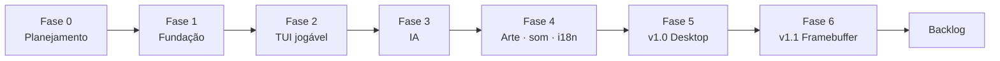

# 06 — Roadmap

## 1. Princípios de entrega

- O jogo deve ser jogável o mais cedo possível; arte e polimento vêm depois do
  núcleo correto.
- Cada fase termina com algo verificável, não apenas com código escrito.
- O backend framebuffer não começa antes de a v1.0 desktop estar estável.
- Nenhuma fase introduz dependência de rede.
- O escopo da v1.0 não cresce com ideias do backlog.

Legenda de esforço: **P** = pequeno, **M** = médio, **G** = grande. As estimativas
são relativas, não prazos.

## 2. Visão geral

## 3. Fase 0 — Planejamento (atual)

**Objetivo:** alinhar escopo, estética, arquitetura e critérios de aceite antes de
escrever código.

Entregáveis:

- [x] README com visão e índice.
- [x] Game design.
- [x] Especificação técnica.
- [x] Design visual e layout.
- [x] Assets e licenças.
- [x] Plano de testes.
- [x] Roadmap.
- [x] Decisões, premissas e riscos.
- [x] Catálogo i18n.

Critérios de saída:

- [ ] O usuário revisou e aprovou as especificações.
- [ ] Licença proposta confirmada ou alterada.
- [ ] Fontes aprovadas.
- [ ] Hardware do Ubuntu Server conhecido o suficiente para a v1.1.
- [ ] Nenhuma questão aberta bloqueante para a Fase 1.

## 4. Fase 1 — Fundação

**Esforço:** M.

**Objetivo:** criar o projeto Rust, o núcleo puro e a base de qualidade.

Entregáveis:

- [x] `Cargo.toml`, `Cargo.lock`, estrutura de módulos.
- [x] CLI inicial com `--help`, `--version`, `--lang`, `--backend`.
- [x] `core::board`, `core::rules`, `core::score` com testes.
- [x] Tipos de estado e máquina de telas mínima.
- [x] Catálogo i18n com pt-BR/inglês.
- [x] Tokens de tema e detecção de cor.
- [x] Guards de terminal (raw mode, alternate screen, cursor).
- [x] Placeholder visual no terminal com o layout vazio.
- [x] Scripts de qualidade (`fmt`, `clippy`, `test`).

Critérios de saída:

- [x] `cargo test` verde para tabuleiro, regras e placar.
- [x] `cargo run` abre e fecha o terminal sem corrompê-lo.
- [x] `--help` e `--version` funcionam.
- [x] `F2` alterna strings de placeholder.
- [x] `cargo fmt --check` e `clippy -D warnings` passam.

## 5. Fase 2 — TUI jogável

**Esforço:** G.

**Objetivo:** entregar uma partida 2P local completa, sem arte final.

**Estado:** concluída em 2026-10-24.

Entregáveis:

- Home, seleção de dificuldade, partida, pausa, fim de rodada.
- Tabuleiro navegável por teclado.
- Detecção de vitória/empate e linha vencedora.
- Placar da sessão e revanche.
- Layouts Wide, Compact e Minimal.
- Resize sem perda de estado.
- Mensagens de jogada inválida.
- Aviso de terminal pequeno.
- Testes de integração e snapshots iniciais.

Critérios de saída:

- [x] Partida 2P completa em 80 × 24 e em 1920 × 1080.
- [x] Revanche alterna o iniciante.
- [x] Nenhuma ação de UI altera o terminal de forma permanente.
- [x] Testes de fluxo e snapshots aprovados.
- [x] `Esc`/`Ctrl+C` restauram o terminal.

## 6. Fase 3 — Inteligência artificial

**Esforço:** M.

**Objetivo:** implementar os três níveis e integrar o modo 1P.

**Estado:** concluída em 2026-10-24.

Entregáveis:

- IA Fácil, Médio e Impossível.
- Tela de dificuldade com descrições.
- Atraso de "pensamento" de 450–800 ms.
- Indicação de turno da IA.
- Testes de legalidade, vitória, bloqueio e prova exaustiva do Impossível.
- `--seed` para reprodutibilidade.

Critérios de saída:

- [x] IA Impossível nunca perde no teste exaustivo.
- [x] Médio vence jogadas ingênuas e bloqueia ameaças imediatas.
- [x] Fácil é vencível com frequência.
- [x] Modo 1P completo e sem travar durante o atraso.
- [x] Pausa durante o turno da IA funciona.

## 7. Fase 4 — Arte, som e i18n

**Esforço:** G.

**Objetivo:** aplicar a identidade "madeira e papel", PNGs, animações, áudio e
interface bilíngue completa.

**Estado:** concluída em 2026-10-24 (Tier A depende de validação manual na Fase 5;
captura de frame entrega a composição de arte, sem a camada textual da v1.1).

Entregáveis:

- [x] SVGs originais e pipeline `xtask` de geração.
- [x] PNGs otimizados, manifesto e checksums.
- [x] Fontes OFL embutidas e licenças.
- [x] Cena do tabuleiro em `tiny-skia` com LOD alto (PNG) e baixo (half-blocks).
- [x] Integração `ratatui-image` (Kitty/Sixel/iTerm2/half-blocks).
- [x] Fallback legado 16 cores.
- [x] Animações de cursor, marca, linha, selo e menus.
- [x] Áudio sintetizado e mudo.
- [x] Traduções completas e revisão de textos.
- [x] `--no-images`, `--no-animations`, `--no-audio`, `--color`.
- [x] Capturas de frame para QA (arte/1344 × 756; texto na v1.1).

Critérios de saída:

- [x] Tier A, B e C implementados e coerentes; Tier A validado manualmente na Fase 5.
- [x] `F2` e `M` funcionam em todas as telas.
- [x] Textos pt/en cabem nos layouts.
- [x] Assets e fontes dentro do orçamento.
- [x] Nenhum terminal testado fica corrompido.
- [x] Animação pode ser desligada sem perda funcional.

## 8. Fase 5 — v1.0 Desktop

**Esforço:** M.

**Objetivo:** estabilizar, medir, documentar e empacotar a versão desktop.

**Estado:** release v1.0.0 validado e empacotado em 2026-10-24. Matriz
automatizada em PTY e matriz manual em Kitty, foot (Sixel), WezTerm (iTerm2),
GNOME Terminal (half-blocks) e áudio real concluídas, conforme
[10 — Checklist de Release](10-v1.0-release-checklist.md).

Entregáveis:

- [x] Matriz automatizada de terminais e protocolos em PTY.
- [x] Matriz visual/manual em Kitty, Sixel, WezTerm/iTerm2, GNOME Terminal e áudio real.
- [x] Ajustes de desempenho e legibilidade.
- [x] Correção de bugs encontrados.
- [x] README final, guia rápido e notas de release.
- [x] `LICENSE`, `LICENSE-ASSETS`/equivalente e `THIRD_PARTY_NOTICES.md`.
- [x] Binário release e `tar.gz`.
- [x] Checklist de release completo.

Critérios de saída (v1.0):

- [x] Todas as metas funcionais de [01 — Game Design](01-game-design.md).
- [x] Portões de qualidade de [05 — Plano de Testes](05-test-plan.md).
- [x] Metas de desempenho atendidas ou desvios justificados.
- [x] Jogo funciona copiado para outro diretório, sem `assets/`.
- [x] Nenhuma pendência bloqueante no backlog (Konsole não testado, fallback documentado).

## 9. Fase 6 — v1.1 Framebuffer

**Esforço:** G.

**Objetivo:** rodar no console local do Ubuntu Server sem X/Wayland, com a mesma
experiência visual.

Entregáveis:

- [x] Detecção e abertura de `/dev/fb0`.
- [x] Suporte a 32/24/16 bpp.
- [x] `KDSETMODE KD_GRAPHICS` e restauração para `KD_TEXT`.
- [x] Entrada de teclado no TTY.
- [x] Composição completa em 1344 × 756 escalada e centralizada.
- [x] Renderização de texto com `fontdue` e fontes embutidas.
- [x] `--backend fb`, `--fb-device` e `--capture-frame` com texto.
- [x] Feature de áudio desligável no build.
- [x] Diagnóstico de permissões e formatos.
- [ ] Testes no servidor real (pendente: grupo `video` e VT local).

Critérios de saída (v1.1):

- [x] Jogo 1P no console local em 1920 × 1080; 2P coberto por testes, spot-check manual pendente.
- [x] Saída pelo menu restaura o console (texto, cursor, modo).
- [ ] `Ctrl+C` e SIGTERM restauram (implementados; teste manual pendente).
- [x] Sem áudio não bloqueia.
- [ ] Capturas de frame aprovadas.
- [x] Instruções de instalação/diagnóstico no README.
- [x] Limitações de fbdev/VT/tearing documentadas.

> Implementação concluída em 2026-10-24; validação manual no VT em 2026-10-25.
> Pacote v1.1.0 gerado. Spot-checks pendentes em
> `docs/12-v1.1-release-checklist.md`.
>
> Patch v1.1.1 (2026-10-28): correção do double buffer/`yoffset`, validação de
> `smem_len` com fallback de pan e `install.sh` com acesso ao grupo `video`.
> Notas em `docs/13-release-notes-v1.1.1.md`.
>
> Patch v1.1.2 (2026-10-28): desbloqueio do framebuffer (`FBIOBLANK`/
> `FB_BLANK_UNBLANK`) ao entrar em `KD_GRAPHICS`, corrigindo a tela em branco
> quando o console chega com `blank`/DPMS desligado. Notas em
> `docs/14-release-notes-v1.1.2.md`.

## 10. Fase 7 — Backlog pós-v1.1

Não faz parte do compromisso atual. Ordem sugerida por valor:

1. Backend DRM/KMS para sistemas sem `/dev/fb0`.
2. Persistência opcional de placar e idioma (arquivo de configuração).
3. Temas alternáveis (neon, CRT, papel claro).
4. Mouse na TUI.
5. Tela de ajuda/tutorial.
6. Modo demonstração IA vs IA.
7. Nomes de jogadores.
8. Tabuleiro 4 × 4 / variantes.
9. Estatísticas e histórico.
10. Instalador/empacotamento para Zorin e Ubuntu.
11. Suporte a SSH com fallback explícito.
12. Localização adicional (espanhol).

Cada item exige uma nova decisão de escopo e, se afetar a arquitetura, um ADR.

## 11. Marcos

| Marco | Entrega | Critério |
| --- | --- | --- |
| M0 | Specs aprovadas | Fase 0 concluída |
| M1 | Fundação | Núcleo testado e terminal restaura |
| M2 | TUI jogável | Partida 2P completa |
| M3 | IA completa | Impossível nunca perde |
| M4 | Identidade visual | Tier A/B/C + som + i18n |
| M5 | v1.0 | Release desktop |
| M6 | v1.1 | Release framebuffer |

## 12. Dependências entre fases

- Fase 2 depende de Fase 1.
- Fase 3 depende do núcleo e da TUI básica.
- Fase 4 depende da TUI jogável e do catálogo i18n.
- Fase 5 depende de 1–4.
- Fase 6 depende da v1.0 congelada e da cena compartilhada da Fase 4.
- Nenhuma fase depende de serviços externos.

## 13. Riscos de cronograma

| Risco | Efeito | Mitigação |
| --- | --- | --- |
| Escopo visual crescer | Atrasa a v1.0 | Orçamento de assets e checklist visual |
| Protocolo de imagem instável | Retrabalho na Fase 4 | Fallback obrigatório e testes por tier |
| Framebuffer exigir hardware específico | Atrasa v1.1 | Testar `/dev/fb0` cedo; DRM no backlog |
| Textos em inglês estourarem | Retrabalho de layout | Catálogo com limites + testes |
| Áudio consumir tempo | Atrasa | Feature desligável; sons simples |
| Perfeccionismo de animação | Atrasa | Durações e easings fixos na spec |

## 14. Checklist de release v1.0

- [ ] Funcionalidades da v1.0 completas.
- [ ] Testes e portões de qualidade verdes.
- [ ] Matriz de terminais executada.
- [ ] Performance medida.
- [ ] Assets/fontes/licenças completos.
- [ ] README e docs atualizados.
- [ ] `--help` e `--version` corretos.
- [ ] Binário testado fora do diretório do projeto.
- [ ] Nenhum terminal corrompido em nenhum caminho de saída.
- [ ] Notas de release escritas.

## 15. Checklist de release v1.1

- [x] Tudo da v1.0 continua válido (185 testes e snapshots).
- [x] Backend fbdev testado em hardware real (1P, menu, áudio, saída).
- [ ] Formatos 32/24/16 bpp validados (32 bpp validado; 24/16 pendentes).
- [x] Permissões e diagnóstico documentados.
- [x] Restauração de console validada na saída pelo menu; `Ctrl+C`/SIGTERM
  pendentes de teste manual.
- [ ] Capturas de frame aprovadas.
- [x] Build sem áudio validado.
- [x] Limitações conhecidas documentadas.
- [x] Notas de release escritas.
- [x] Pacote `tar.gz` + `.sha256` gerado e testado em `/tmp`.
